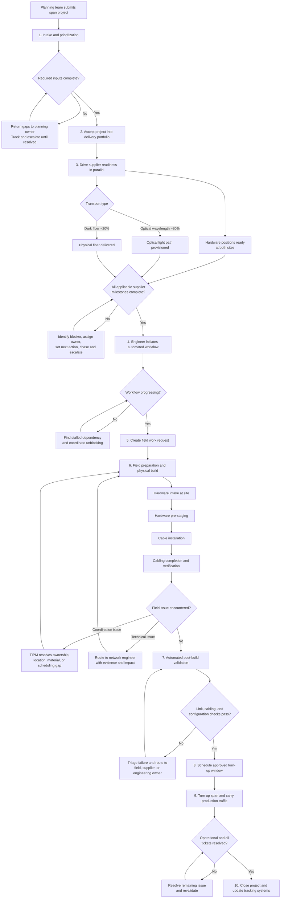

# Amazon Data Center Interconnect Span Delivery Workflow

## Purpose and scope

This workflow translates the supplied TIPM job description into an operating model for delivering a data center interconnect **span**: a physical and logical network connection that carries production traffic between two AWS data centers.

The TIPM owns coordination from project acceptance by the delivery team through operational turn-up and closure. Network engineers retain technical design, configuration, automation, and technical troubleshooting ownership.

The source describes a portfolio of approximately 120 spans per month:

| Work type | Portfolio share |
|---|---:|
| New builds | 57% |
| Capacity expansions | 38% |
| Decommissions | 5% |

## End-to-end workflow

## Stage gates and operating procedure

| Stage | TIPM actions | Exit gate / evidence | Primary partners |
|---|---|---|---|
| 1. Intake and prioritization | Confirm work type, business priority, capacity deadline, both sites, transport type, and owners. Place the project in the portfolio queue. | Priority and required dates are visible; project owner and delivery path are identified. | Planning team, DA manager |
| 2. Acceptance readiness | Validate hardware positions, fiber paths, and port reservations before engineering accepts the work. Log every missing input with an owner and next action. | All required planning inputs are complete and accepted. | Planning team, network engineering |
| 3. Supplier readiness | Track 3-5 dependent supplier teams in parallel. Require hardware readiness at both sites plus the applicable optical wavelength or dark-fiber path. Chase blockers and escalate aging dependencies. | Every applicable supplier milestone is complete or has explicit engineering-approved handling. | Hardware, optical, fiber, planning teams |
| 4. Workflow preparation | Track the engineer-initiated automated workflow. Identify steps waiting on supplier milestones and coordinate resolution. | Automated preparation reaches the field-ready state. | Network engineering, suppliers |
| 5. Field handoff | Create a complete work request with cutsheet, rack locations, cable specifications, site details, dependencies, priority, and requested window. | Field team accepts an actionable request with no missing information. | Data center field team, engineering |
| 6. Physical build | Manage the field queue and monitor hardware intake, pre-staging, cable installation, completion, and verification. Protect engineers from coordination interruptions. | Field work is complete and documented at both sites. | Field team, hardware team |
| 7. Troubleshooting | Classify every field escalation. Resolve coordination issues; route technical issues to engineering with symptoms, evidence, impact, and requested decision. | Issue owner accepts the case and the recovery action is tracked to completion. | Field team, engineering, suppliers |
| 8. Validation | Monitor automated link validation, cabling checks, and configuration verification. Route failures to the correct owner and repeat affected checks. | All required validation checks pass. | Network engineering, field team |
| 9. Turn-up | Confirm approvals and controlled maintenance window, then schedule and track production turn-up within the applicable SLA. | Span is operational and carrying production traffic. | Engineering, operations, change approvers |
| 10. Closure | Verify operational state, resolve or link all tickets, record actual milestone dates and blockers, and mark the project complete. | Tracking systems agree that the span is live and the project is closed. | Engineering, operations, DA manager |

## Field execution milestone targets

The job description gives the following targets. They should be tracked as individual milestones; it does not state that they are sequential or additive.

| Milestone | Target |
|---|---:|
| Hardware intake at site | 21 days |
| Hardware pre-staging | 14 days |
| Cable installation | 7 days |
| Cabling completion and verification | 7-14 days |

## Exception routing

Use one decision rule whenever a project stalls:

1. **Describe the failure:** expected milestone, current state, elapsed time, and delivery impact.
2. **Classify the cause:** missing planning input, supplier dependency, field coordination, technical fault, change-window constraint, or unclear ownership.
3. **Route it:** TIPM resolves coordination and ownership gaps; engineers resolve technical design, configuration, automation, and technical faults.
4. **Record the recovery:** accountable owner, next action, due date, escalation level, and next checkpoint.
5. **Escalate patterns:** raise recurring supplier lateness, regional field-capacity constraints, or repeated workflow failures to the DA manager before deadlines are missed.

## Portfolio control loop

The TIPM manages 20-40 concurrent projects and supports a follow-the-sun operation across Dublin and Seattle.

### Daily

- Review projects due or blocked in the next 24-72 hours.
- Unblock critical-capacity projects first, using the DA manager's priority order.
- Confirm each blocked project has one cause, one accountable owner, one dated next action, and a scheduled follow-up.
- Hand off active risks between Dublin and Seattle with current status and the next expected event.
- Triage field escalations and shield engineers from nontechnical coordination work.

### Weekly

- Report portfolio health by phase: on track, at risk, blocked, and completed.
- Review milestone aging and the leading blocker categories.
- Identify repeated failures by supplier, region, workflow step, and field team.
- Escalate systemic constraints and agree on corrective actions with the DA manager.
- Update handoff checklists, escalation paths, and operating procedures from lessons learned.

## Minimum project record

Each span should have these fields in the tracking system:

| Category | Required fields |
|---|---|
| Identity | Span/project ID, work type, Site A, Site B, region, priority, critical-capacity date |
| Technical coordination | Transport type, hardware positions, port reservations, fiber path, cutsheet, cable specification |
| Ownership | TIPM, planning owner, engineer, field owner, hardware owner, optical/fiber owner |
| Milestones | Intake date, acceptance date, supplier-ready dates, workflow-ready date, field milestones, validation date, turn-up date, closure date |
| Blocker control | Blocker category, description, owner, next action, due date, escalation level, last update |
| Closure | Validation result, operational confirmation, ticket status, completion date, lessons/pattern tag |

## Success measures

- No project stalls because of missing coordination or unclear ownership.
- Engineers spend less time chasing suppliers and handling nontechnical field issues; the job description identifies roughly 20% of engineering capacity as the current pain point.
- Every project has visible phase, status, blocker, owner, and next action.
- Milestone performance becomes consistent enough to sustain the approximate 120-span monthly cadence.
- Systemic issues are detected and escalated before they cause missed delivery dates.

## Source boundary and assumptions

This workflow is derived only from the supplied `TIPM Job Description.pdf`. The source does not define supplier SLAs, the name of the automated workflow, exact validation commands, approval systems, ticketing tools, escalation thresholds, or a single additive end-to-end lead time. Those details should be filled in with internal process documentation and team agreements rather than inferred here.
