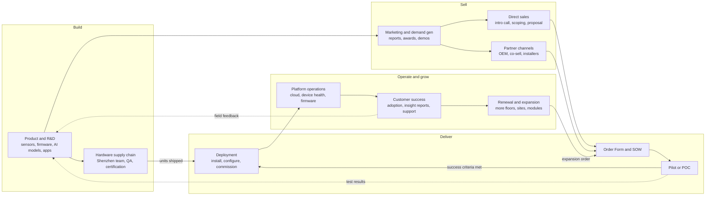
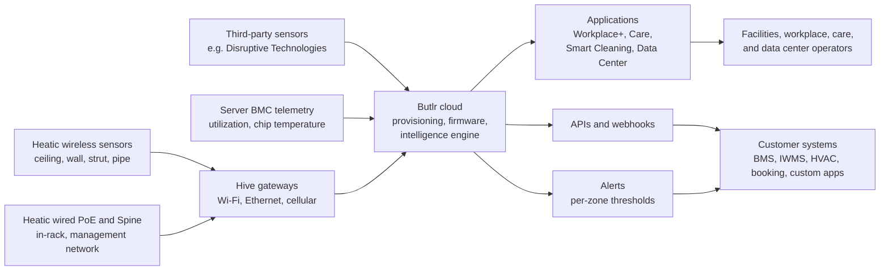
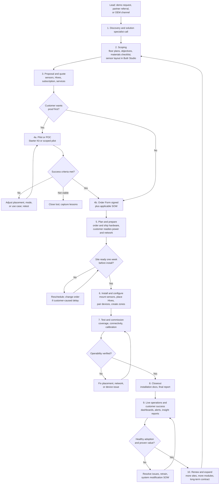

# How Butlr Runs Its Business: End-to-End Workflow

## Purpose and scope

This page maps how Butlr turns a thermal sensor and a cloud platform into recurring revenue: how it builds product, sells, deploys, operates, supports, and expands accounts. The data center program workflow owned by the **Senior Program Manager, Data Operations** role is on its own page: [Butlr Data Center Program Workflow](butlr-data-center-program-workflow.md).

Every statement is tagged by where it comes from:

- **Sourced:** stated in the job description or in Butlr's public pages (see [Sources](#sources)).
- **Inferred:** a reasonable reading of how the sourced pieces connect. Confirm these in interviews.

## Butlr at a glance

| Dimension | What Butlr does | Basis |
|---|---|---|
| Mission | Make the built environment "people-aware" while respecting privacy | Sourced (JD) |
| Origin | MIT Media Lab spinout (2019); founders Honghao Deng and Jiani Zeng; offices in Silicon Valley and Boston | Sourced (JD) |
| Core technology | Low-resolution thermal sensing plus AI. Detects presence, counts, traffic, posture, and equipment surface heat without images or PII | Sourced |
| Hardware | Heatic 2+ wireless (multi-year battery), Heatic wired PoE, Heatic Spine rack sensor (USB-C power and data), Hive gateways (Wi-Fi, Ethernet, cellular) | Sourced |
| Software | Intelligence engine (occupancy modeling, traffic, thermal mapping, alerts), Butlr Studio (virtual space setup), apps, APIs and webhooks, Ask Butlr AI analyst | Sourced |
| Applications | Workplace+ (CRE and offices), Butlr Care (fall detection, resident safety), Smart Cleaning (restroom usage), Butlr Data Center (power-path thermal monitoring, thermal digital twin) | Sourced |
| Revenue model | Quote-based hardware plus software subscription; Starter Kit (1 Hive, 3 sensors, 12 months software and API); paid services under SOWs | Sourced (third-party listing and Butlr SOWs) |
| Channels | Direct sales; OEM and embedded (Carrier Abound); co-sell and data partnerships (Disruptive Technologies, GP Pro, Propstack); certified installation partners | Sourced |
| Data center ecosystem | Technology partners Kentec, ASPEED, Cupola360, Provocative | Sourced (DC page) |
| Global operations | Customers in North America, Europe, Asia; a Shenzhen team; customs and import logistics for equipment | Sourced (JD) |
| Investors | Foundry Group, Tiger Global, Qualcomm Ventures, E14 Fund, Carrier, others | Sourced (JD) |

## 1. Business operating model (value chain)

How the parts of the company hand work to each other. The loop at the bottom is what makes it a subscription business: deployed sensors generate data, data proves value, value drives renewal and expansion, and field learnings feed the next product release.

| Function | What it owns | Hands off to | Basis |
|---|---|---|---|
| Product and R&D | Sensor hardware, firmware, intelligence engine, applications, APIs | Supply chain (designs), Marketing (launches) | Sourced (products); handoffs inferred |
| Supply chain and logistics | Configure, test, QA, and ship units; customs and import across borders | Deployment team, POC sites | Sourced (JD) |
| Sales and partners | Discovery, scoping inputs (floor plans, objectives), proposal, Order Form | Delivery (signed scope) | Sourced (sales path); handoff inferred |
| Delivery and installation | Site survey, install, configure zones, commission, closeout report | Platform ops and customer success | Sourced (installation SOW) |
| Platform operations | Device provisioning, firmware, cloud processing, audit and compliance, data pipelines | Customer-facing apps and APIs | Sourced (ecosystem page) |
| Customer success | Adoption, check-ins, issue resolution, insight reports, partner enablement | Sales (expansion), Product (feedback) | Sourced (services list, JD) |

## 2. Platform data flow (what the customer actually buys)

The hardware is the entry point and the cost of acquisition. The recurring value sits in the cloud layer: analytics, alerts, AI query tools, and integrations into systems the customer already runs. *(Inferred from the hardware plus subscription model.)*

## 3. Customer lifecycle: land, prove, deploy, expand

### Stage gates

| Stage | Key activities | Exit gate | Owner | Basis |
|---|---|---|---|---|
| 1. Discovery | Demo tailored to the customer's spaces | Qualified use case and buyer | Sales, solution specialist | Sourced |
| 2. Scoping | Floor plans, objectives, materials checklist, sensor layout and virtual space | Bill of materials and layout | Sales, solutions | Sourced |
| 3. Proposal | Hardware, subscription, services priced | Accepted quote | Sales | Sourced |
| 4a. Pilot / POC | Limited deployment against agreed success criteria | Go / no-go decision | Delivery, engineering | Sourced (pilot program FAQ, JD); criteria inferred |
| 4b. Contract | Order Form plus SOW (installation, system modification, break-fix) | Signed scope | Sales, legal | Sourced (SOWs) |
| 5. Prepare | Ship hardware; customer provides power, network, access, staging space | Site readiness confirmed one week out; install within 60 days of signature | Delivery, customer | Sourced (installation SOW) |
| 6. Install | Mount, connect, configure, pair, zone | Devices online | Butlr or certified installer | Sourced |
| 7. Commission | Functional, connectivity, and calibration tests | Operability verified | Delivery | Sourced |
| 8. Closeout | Documentation and final report | Handoff to operations | Delivery | Sourced |
| 9. Operate | Monitoring, adoption, support, insight reports | Value proven to buyer | Customer success | Sourced (services); gate inferred |
| 10. Expand | More floors, sites, modules (Care, Smart Cleaning, Energy, Data Center) | Expansion order | Customer success, Sales | Inferred |

Butlr states a typical implementation runs **at least 4 weeks**, longer for large or complex sites. Standard on-site installs run on a 4-day work week. *(Sourced.)*

## Business levers and likely metrics (inferred)

| Lever | Why it matters | Metrics to ask about |
|---|---|---|
| Time to value | Subscription revenue starts when sensors produce trusted data | Days from signature to go-live; POC cycle time |
| POC conversion | Data center POCs are expensive; conversion pays for them | POC-to-contract rate; expansion revenue per account |
| Hardware reliability | Battery life and uptime drive support cost and trust | Device online rate; field failure rate; RMA turnaround |
| Logistics | Cross-border shipments can stall a pilot | Ship-to-site lead time; customs hold time |
| Land and expand | Starter Kit lowers entry; value expands by site and module | Net revenue retention; sites and modules per customer |
| Repeatability | Playbooks lower delivery cost per site | Delivery hours per site; repeat issues per deployment |

## Where Dao's background maps

| Butlr need | Matching experience |
|---|---|
| Turn deal commitments into an owned plan | ByteDance three-phase capacity pipeline (demand intake, feasibility workshop, customer validation and delivery) |
| Pilots before configuration decisions | Runs POCs with China partners before settling NPI server configuration |
| Hardware logistics, customs, Shenzhen coordination | Edge PoP builds with equipment import, customs, and compliance; native Mandarin |
| Live data center environments | Edge PoP builds in colocation facilities; Equinix and Digital Realty deliveries; CDCP |
| Environmental and thermal monitoring | Environment monitoring work at Delta and Paylocity |
| Make it repeatable | ByteDance SOP framework built from scratch |
| Gap to address honestly | Post-launch external customer success and account ownership; delivery customers have been internal |

## Questions to confirm in interviews

1. How many data center POCs are active now, and what does a typical one cost and take?
2. What are the written success criteria for converting a data center POC?
3. Is the CFD comparison a standard validation step or customer-specific?
4. Where are units built and configured, and who owns customs and import today?
5. How is the data center offering priced: per rack, per MW, per sensor, or per site?
6. Who owns the account after expansion: this role, Sales, or a CSM?

## Sources

- Butlr, *Senior Program Manager, Data Operations* job description (BambooHR, accessed 29 Oct 2026)
- [Butlr Data Center solution](https://www.butlr.com/solutions/data-center)
- [How Butlr addresses the data center energy efficiency challenge](https://www.butlr.com/blog/how-butlr-addresses-the-data-center-energy-efficiency-challenge)
- [Butlr platform overview (support)](https://support.butlr.io/hc/en-us/articles/33781555446285)
- [Understanding the Butlr Ecosystem](https://support.butlr.io/hc/en-us/articles/46194494315533-Understanding-the-Butlr-Ecosystem)
- [What products and services does Butlr offer?](https://support.butlr.io/hc/en-us/articles/41507309145869-What-products-and-services-does-Butlr-offer)
- [What is the installation process like?](https://support.butlr.io/hc/en-us/articles/41507836020621-What-is-the-installation-process-like)
- [What is the typical implementation timeline?](https://support.butlr.io/hc/en-us/articles/41507809914637-What-is-the-typical-implementation-timeline)
- [Workplace: On-Site Installation SOW](https://www.butlr.com/statements-of-work/workplace-on-site-installation)
- [Butlr Workplace pricing summary (FitGap)](https://us.fitgap.com/products/029786/butlr-workplace)
- [Butlr and Disruptive Technologies partnership (Business Wire, Mar 2026)](https://www.businesswire.com/news/home/20260312111938/en/)
- [Butlr's new thermal sensor products (Commercial Observer, Sep 2026)](https://commercialobserver.com/2026/09/butlr-new-thermal-sensor-products/)
- [Butlr Technologies (Wikipedia)](https://en.wikipedia.org/wiki/Butlr_Technologies)

## Source boundary and assumptions

Butlr does not publish its internal org chart, pricing, POC success criteria, manufacturing locations beyond the JD's mention of a Shenzhen team, or data center customer names. Data center payback figures on Butlr's site are company-modeled, not realized results, and are left out of this workflow. Handoffs between functions, stage-gate evidence, and the metrics table are inferred and should be validated with the hiring team.
