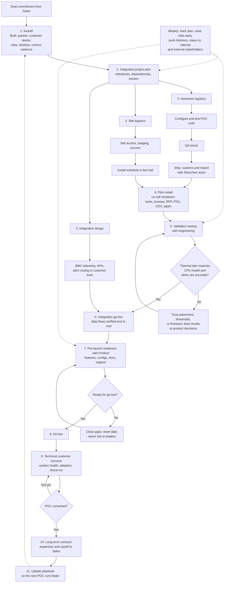

# Butlr Data Center Program Workflow

## Purpose and scope

This page maps the data center program workflow owned by Butlr's **Senior Program Manager, Data Operations** role, from signed deal through go-live, technical customer success, and expansion. For how the rest of the company operates, see [How Butlr Runs Its Business](butlr-business-workflow.md).

Stages, actions, and partners come from the job description and the Butlr Data Center page. The specific evidence for each gate is inferred and should be confirmed in interviews.

## End-to-end workflow

The data center line is newer and higher stakes than workplace occupancy. Butlr positions it as a continuous power-path thermal monitoring layer and thermal digital twin for AI data centers, installed without hall shutdowns. The JD makes this role the single owner from signed deal to expansion.

## Stage gates

| Stage | PM actions | Exit gate / evidence | Partners |
|---|---|---|---|
| 1. Kickoff | Convene Butlr, partner, and customer teams fast; set roles, timeline, and comms | Agreed RACI and cadence | Sales, customer DC ops, partners |
| 2. Plan | Convert deal commitments into milestones, dependencies, and owners | Baseline plan accepted by both sides | Engineering, Product, Supply Chain |
| 3a. Hardware logistics | Units configured, tested, QA'd, shipped; customs and import cleared | Units on site, serials logged | Supply Chain, Shenzhen team, customs broker |
| 3b. Site logistics | Site access, escorts, install windows, customer requirements | Install window confirmed | Customer facilities and security |
| 3c. Integration design | BMC telemetry, API and alert routing to customer tools | Interface agreement signed off | Butlr and customer engineering |
| 4. Pilot install | Deploy across the power path and cooling loop without hall shutdown | Devices online and reporting | Field engineering, installers |
| 5. Validation | Plan and run tests; compare thermal twin to CFD; check alert accuracy | Test report with product and deployment decisions | Engineering, Product |
| 6. Integration go-live | Confirm data flows end to end on schedule | Data visible in customer systems | Both engineering teams |
| 7. Pre-launch readiness | Features, configurations, documentation, support staffed | Readiness checklist complete | Product, Support |
| 8. Go-live | Controlled launch | Customer acceptance | Customer DC ops |
| 9. Technical customer success | Monitor system health and adoption; regular check-ins; fast issue resolution | Adoption and health targets met | Support, Engineering |
| 10. Expand | Convert POC to long-term contract; spot upsell; hand to Sales | Expansion opportunity in pipeline | Sales |
| 11. Playbook | Capture lessons learned; shorten next cycle | Updated playbook and templates | All |

## Sources

- Butlr, *Senior Program Manager, Data Operations* job description (BambooHR, accessed 29 Oct 2026)
- [Butlr Data Center solution](https://www.butlr.com/solutions/data-center)
- [How Butlr addresses the data center energy efficiency challenge](https://www.butlr.com/blog/how-butlr-addresses-the-data-center-energy-efficiency-challenge)
- [Butlr platform overview (support)](https://support.butlr.io/hc/en-us/articles/33781555446285)
- [Understanding the Butlr Ecosystem](https://support.butlr.io/hc/en-us/articles/46194494315533-Understanding-the-Butlr-Ecosystem)
- [What products and services does Butlr offer?](https://support.butlr.io/hc/en-us/articles/41507309145869-What-products-and-services-does-Butlr-offer)
- [What is the installation process like?](https://support.butlr.io/hc/en-us/articles/41507836020621-What-is-the-installation-process-like)
- [What is the typical implementation timeline?](https://support.butlr.io/hc/en-us/articles/41507809914637-What-is-the-typical-implementation-timeline)
- [Workplace: On-Site Installation SOW](https://www.butlr.com/statements-of-work/workplace-on-site-installation)
- [Butlr Workplace pricing summary (FitGap)](https://us.fitgap.com/products/029786/butlr-workplace)
- [Butlr and Disruptive Technologies partnership (Business Wire, Mar 2026)](https://www.businesswire.com/news/home/20260312111938/en/)
- [Butlr's new thermal sensor products (Commercial Observer, Sep 2026)](https://commercialobserver.com/2026/09/butlr-new-thermal-sensor-products/)
- [Butlr Technologies (Wikipedia)](https://en.wikipedia.org/wiki/Butlr_Technologies)

## Source boundary and assumptions

Butlr does not publish its internal org chart, pricing, POC success criteria, manufacturing locations beyond the JD's mention of a Shenzhen team, or data center customer names. Data center payback figures on Butlr's site are company-modeled, not realized results, and are left out of this workflow. Handoffs between functions, stage-gate evidence, and the metrics table are inferred and should be validated with the hiring team.
