# Butlr Data Center Program Workflow

## Purpose and scope

This page maps the data center program workflow owned by Butlr's **Senior Program Manager, Data Operations** role, from signed deal through go-live, technical customer success, and expansion. For how the rest of the company operates, see [How Butlr Runs Its Business](butlr-business-workflow.md).

Tasks and partners come from the job description and the Butlr Data Center page. The phase grouping and gate evidence are inferred and should be confirmed in interviews.

## End-to-end workflow

The data center line is newer and higher stakes than workplace occupancy. Butlr positions it as a continuous power-path thermal monitoring layer and thermal digital twin for AI data centers, installed without hall shutdowns. The JD makes this role the single owner from signed deal to expansion.

Five phases run left to right. Each phase lists its main tasks, and a gate (G1 to G5) controls entry to the next phase. A failed gate loops back to its phase.

```mermaid
flowchart LR
    START([Deal commitment<br/>from Sales]) --> P1

    subgraph P1["Phase 1: Initiate"]
        direction TB
        T11[Kick off with Butlr,<br/>partner, customer teams]
        T12[Set roles, timeline,<br/>comms cadence]
        T13[Turn deal commitments<br/>into integrated plan]
        T14[Milestones, dependencies,<br/>owners baselined]
        T11 --> T12 --> T13 --> T14
    end

    P1 --> G1{"G1<br/>Plan<br/>approved"}
    G1 -- Yes --> P2
    G1 -. No .-> P1

    subgraph P2["Phase 2: Prepare"]
        direction TB
        T21[Configure, test, QA<br/>POC units]
        T22[Ship; customs and import<br/>with Shenzhen team]
        T23[Site access, badging,<br/>install windows]
        T24[Integration design:<br/>BMC telemetry, APIs,<br/>alert routing]
        T21 --> T22 --> T23 --> T24
    end

    P2 --> G2{"G2<br/>Site and<br/>hardware<br/>ready"}
    G2 -- Yes --> P3
    G2 -. No .-> P2

    subgraph P3["Phase 3: Pilot and validate"]
        direction TB
        T31[Install in live hall,<br/>no shutdown]
        T32[Cover racks, busway,<br/>RPP, PDU, CDU, pipes]
        T33[Run validation tests<br/>with engineering]
        T34[Compare thermal twin<br/>to CFD; tune thresholds]
        T31 --> T32 --> T33 --> T34
    end

    P3 --> G3{"G3<br/>Validation<br/>passed"}
    G3 -- Yes --> P4
    G3 -. No .-> P3

    subgraph P4["Phase 4: Integrate and launch"]
        direction TB
        T41[Integration go-live;<br/>data flows verified]
        T42[Pre-launch readiness<br/>with Product]
        T43[Features, configs,<br/>docs, support ready]
        T44[Controlled go-live]
        T41 --> T42 --> T43 --> T44
    end

    P4 --> G4{"G4<br/>Customer<br/>acceptance"}
    G4 -- Yes --> P5
    G4 -. No .-> P4

    subgraph P5["Phase 5: Operate and expand"]
        direction TB
        T51[Technical customer<br/>success lead]
        T52[Monitor system health<br/>and adoption]
        T53[Regular check-ins;<br/>resolve issues fast]
        T54[Spot expansion and<br/>upsell; bring to Sales]
        T51 --> T52 --> T53 --> T54
    end

    P5 --> G5{"G5<br/>POC<br/>converted"}
    G5 -- Yes --> END([Long-term contract;<br/>playbook updated])
    G5 -. Not yet .-> P5

    classDef gate fill:#1B3D4F,stroke:#1B3D4F,color:#ffffff,font-weight:bold
    classDef phase fill:#f4f8fa,stroke:#1B3D4F,stroke-width:1.5px
    classDef ends fill:#e8eef1,stroke:#1B3D4F
    class G1,G2,G3,G4,G5 gate
    class P1,P2,P3,P4,P5 phase
    class START,END ends
```

**Runs across all phases (weekly governance):** track the plan, raise risks early, push blockers to resolution, and report status to internal leaders and external stakeholders.

## Phases and gates

| Phase | Main tasks | Gate to exit | Gate evidence | Partners |
|---|---|---|---|---|
| 1. Initiate | Kick off Butlr, partner, and customer teams fast; set roles, timeline, and comms; turn deal commitments into a plan with milestones, dependencies, and owners | **G1: Plan approved** | Agreed RACI and cadence; baseline plan accepted by both sides | Sales, customer DC ops, partners, Engineering, Product |
| 2. Prepare | Configure, test, and QA POC units; ship and clear customs with the Shenzhen team; arrange site access and install windows; design BMC, API, and alert integrations | **G2: Site and hardware ready** | Units on site with serials logged; install window confirmed; interface agreement signed off | Supply Chain, Shenzhen team, customs broker, customer facilities and security |
| 3. Pilot and validate | Install across the power path and cooling loop without hall shutdown; run validation tests; compare thermal twin to CFD; tune placement, thresholds, or firmware | **G3: Validation passed** | Devices online and reporting; test report with product and deployment decisions; alert accuracy confirmed | Field engineering, installers, Engineering, Product |
| 4. Integrate and launch | Take integrations live and verify data flows; confirm features, configurations, documentation, and support with Product; run a controlled go-live | **G4: Customer acceptance** | Data visible in customer systems; readiness checklist complete; customer sign-off | Butlr and customer engineering, Product, Support, customer DC ops |
| 5. Operate and expand | Act as technical customer success lead; monitor system health and adoption; run regular check-ins; resolve issues fast; spot expansion and upsell for Sales | **G5: POC converted** | Adoption and health targets met; long-term contract or expansion in pipeline; playbook updated so the next POC runs faster | Support, Engineering, Sales |

Phase tasks come from the JD and the Butlr Data Center page. Grouping into five phases and the gate evidence are inferred and should be confirmed in interviews.

## Sources

- Butlr, *Senior Program Manager, Data Operations* job description (BambooHR, accessed 29 Oct 2026)
- [Butlr Data Center solution](https://www.butlr.com/solutions/data-center)
- [How Butlr addresses the data center energy efficiency challenge](https://www.butlr.com/blog/how-butlr-addresses-the-data-center-energy-efficiency-challenge)
- [Butlr platform overview (support)](https://support.butlr.io/hc/en-us/articles/33781555446285)
- [Understanding the Butlr Ecosystem](https://support.butlr.io/hc/en-us/articles/46194494315533-Understanding-the-Butlr-Ecosystem)
- [What products and services does Butlr offer?](https://support.butlr.io/hc/en-us/articles/41507309145869-What-products-and-services-does-Butlr-offer)
- [What is the installation process like?](https://support.butlr.io/hc/en-us/articles/41507836020621-What-is-the-installation-process-like)
- [What is the typical implementation timeline?](https://support.butlr.io/hc/en-us/articles/41507809914637-What-is-the-typical-implementation-timeline)
- [Workplace: On-Site Installation SOW](https://www.butlr.com/statements-of-work/workplace-on-site-installation)
- [Butlr Workplace pricing summary (FitGap)](https://us.fitgap.com/products/029786/butlr-workplace)
- [Butlr and Disruptive Technologies partnership (Business Wire, Mar 2026)](https://www.businesswire.com/news/home/20260312111938/en/)
- [Butlr's new thermal sensor products (Commercial Observer, Sep 2026)](https://commercialobserver.com/2026/09/butlr-new-thermal-sensor-products/)
- [Butlr Technologies (Wikipedia)](https://en.wikipedia.org/wiki/Butlr_Technologies)

## Source boundary and assumptions

Butlr does not publish its internal org chart, pricing, POC success criteria, manufacturing locations beyond the JD's mention of a Shenzhen team, or data center customer names. Data center payback figures on Butlr's site are company-modeled, not realized results, and are left out of this workflow. Handoffs between functions, stage-gate evidence, and the metrics table are inferred and should be validated with the hiring team.
