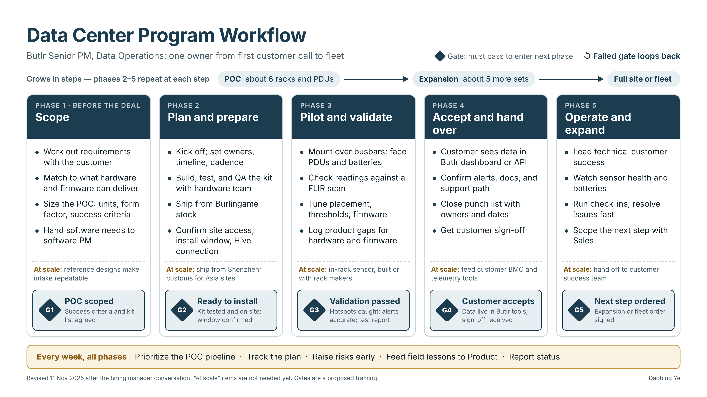

# Butlr Data Center Program Workflow

## Purpose and scope

This page maps the data center program workflow owned by Butlr's **Senior Program Manager, Data Operations** role, from the first customer conversation through POC, expansion, and full-fleet rollout. For how the rest of the company operates, see [How Butlr Runs Its Business](butlr-business-workflow.md).

*Revised 11 Nov 2026 after the hiring manager conversation. The workflow now reflects how the data center line runs today (small POCs that grow in steps) and marks which steps only matter at scale.*

## End-to-end workflow

The data center line runs like a seed-stage startup inside Butlr. Customers are smaller sites, such as containerized data centers. The thermal sensors replace manual FLIR (handheld infrared) scans done every 3 to 6 months by continuously watching the power path for hotspots. This role owns the work end to end, starting before the deal is signed.

Five phases run left to right. Each phase lists its main tasks, and a gate (G1 to G5) controls entry to the next phase. A failed gate loops back to its phase. Each phase also notes what changes **at scale**: steps that aren't needed for today's small orders but will be as the line grows.

Presentation versions: [full-screen page](butlr-data-center-diagram.html) · [PDF slide](assets/butlr-data-center-workflow.pdf) · [PNG](assets/butlr-data-center-workflow.png)

### Customers grow in steps

| Step | Typical size | What happens |
|---|---|---|
| POC | About 6 racks and PDUs | Prove the sensors catch hotspots at the customer's site |
| Expansion | About 5 more sets | Phases 2 to 5 repeat at larger size |
| Full site or fleet | Whole data center or fleet | Phases 2 to 5 repeat; the at-scale steps switch on |

**Runs across all phases (weekly governance):** prioritize the POC pipeline (demand is larger than the team can handle today), track the plan, raise risks early, feed field lessons back to Product, and report status inside and outside Butlr.

## Phases and gates

| Phase | Main tasks today | At scale | Gate to exit | Gate evidence | Partners |
|---|---|---|---|---|---|
| 1. Scope (before the deal) | Work out requirements with the customer; match them to what hardware and firmware can deliver; size the POC (units, form factor, success criteria); hand software needs to the software PM | Reference designs make intake repeatable | **G1: POC scoped** | Success criteria and kit list agreed with the customer | Sales, customer DC ops, hardware, firmware, test, software PM |
| 2. Plan and prepare | Kick off; set owners, timeline, and cadence; build, test, and QA the kit with the hardware team; ship from Burlingame stock; confirm site access, install window, and how the Hive gateway connects (Wi-Fi, Ethernet, or cellular) | Ship from Shenzhen; customs and compliance for Asia sites | **G2: Ready to install** | Kit tested and on site with serials logged; install window confirmed | Hardware, test, fulfillment, customer facilities and security |
| 3. Pilot and validate | Mount sensors over busbars and facing PDUs and batteries; check readings against a FLIR scan; tune placement, thresholds, or firmware; log product gaps for hardware and firmware | In-rack sensor, built by Butlr or integrated with rack makers | **G3: Validation passed** | Devices reporting; known hotspots caught; alerts accurate; test report | Hardware, firmware, test, algorithms team, customer DC ops |
| 4. Accept and hand over | Customer sees data in the Butlr dashboard or API; confirm alerts, docs, and support path; close the punch list with owners and dates; get customer sign-off | Feed data into the customer's BMC and telemetry tools | **G4: Customer accepts** | Data live in Butlr tools; punch list closed or owned; sign-off received | Software PM, Support, customer DC ops |
| 5. Operate and expand | Lead technical customer success; watch sensor health and batteries; run check-ins and resolve issues fast; scope the next step with Sales | Hand off to the customer success team | **G5: Next step ordered** | Expansion or fleet order signed; playbook updated so the next POC runs faster | Sales, Support, Engineering |

Phase grouping and gate evidence are a proposed framing to confirm with the hiring team.

## What changed after the hiring manager conversation

| Earlier version | Revised | Why |
|---|---|---|
| Started at a signed deal | Added Phase 1, Scope, before the deal | The role works with customers on requirements and plans the POC |
| One POC, then full rollout | POC, then expansion, then full site or fleet | Customers grow in steps |
| Ship and clear customs with the Shenzhen team | Ship from Burlingame stock; customs moves to "at scale" | Today's orders are small and ship from the US |
| Design and go live with BMC, API, and alert integrations | Customer uses the Butlr dashboard or API; BMC and telemetry feeds move to "at scale" | Customers already have their own telemetry; Butlr stays separate for now |
| Cover racks, busway, RPP, PDU, CDU, pipes; compare to CFD | Busbars, PDUs, and batteries; compare to a FLIR scan | There's no cooling product yet; the product replaces manual FLIR scans |
| No feedback loop to Product | "Log product gaps" in Phase 3 and "Feed field lessons to Product" weekly | The role helps shape the product for this market |

## Sources

- Butlr, *Senior Program Manager, Data Operations* job description (BambooHR, accessed 29 Oct 2026)
- [Butlr Data Center solution](https://www.butlr.com/solutions/data-center)
- [How Butlr addresses the data center energy efficiency challenge](https://www.butlr.com/blog/how-butlr-addresses-the-data-center-energy-efficiency-challenge)
- [Butlr platform overview (support)](https://support.butlr.io/hc/en-us/articles/33781555446285)
- [Understanding the Butlr Ecosystem](https://support.butlr.io/hc/en-us/articles/46194494315533-Understanding-the-Butlr-Ecosystem)
- [What products and services does Butlr offer?](https://support.butlr.io/hc/en-us/articles/41507309145869-What-products-and-services-does-Butlr-offer)
- [What is the installation process like?](https://support.butlr.io/hc/en-us/articles/41507836020621-What-is-the-installation-process-like)
- [What is the typical implementation timeline?](https://support.butlr.io/hc/en-us/articles/41507809914637-What-is-the-typical-implementation-timeline)
- [Workplace: On-Site Installation SOW](https://www.butlr.com/statements-of-work/workplace-on-site-installation)
- [Butlr Workplace pricing summary (FitGap)](https://us.fitgap.com/products/029786/butlr-workplace)
- [Butlr and Disruptive Technologies partnership (Business Wire, Mar 2026)](https://www.businesswire.com/news/home/20260312111938/en/)
- [Butlr's new thermal sensor products (Commercial Observer, Sep 2026)](https://commercialobserver.com/2026/09/butlr-new-thermal-sensor-products/)
- [Butlr Technologies (Wikipedia)](https://en.wikipedia.org/wiki/Butlr_Technologies)

## Source boundary and assumptions

Butlr does not publish its internal org chart, pricing, POC success criteria, or data center customer names. Data center payback figures on Butlr's site are company-modeled, not realized results, and are left out of this workflow. Handoffs between functions and stage-gate evidence are inferred and should be validated with the hiring team.
