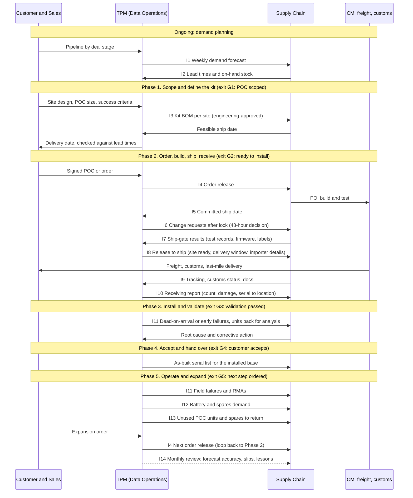

# Butlr Data Center Supply Chain Workflow

## Purpose and scope

This page maps the supply chain side of a Butlr data center deployment: what happens from the first demand signal to field returns and expansion orders, who owns each step, and where Supply Chain and the TPM (Senior Program Manager, Data Operations) hand work to each other. It follows the same five phases and gates (G1 to G5) as the [Butlr data center program workflow](butlr-data-center-program-workflow.md).

**Ownership rule:** the TPM owns *what* the customer needs and *when*, plus everything at the customer's site. Supply Chain owns *how* it is built and moved: suppliers, the contract manufacturer (CM), build, test, QC, inventory, freight, and customs. Engineering owns the design and the certifications.

*Today vs at scale.* Today's POCs are small (about 6 racks and PDUs) and ship from Burlingame stock, with no customs. At scale, kits ship from the CM or the Shenzhen team, international sites add customs and certification work, and fleet upkeep (spares, returns, batteries) becomes ongoing demand. Each phase below marks what switches on at scale.

## Workflow at a glance

The diagram shows who passes what to whom in each phase. Interface numbers (I1 to I14) match the interface table further down.

## Phases, tasks, and owners

**Owner** does the work and is accountable for it. **Supports** gives input or approval.

### Ongoing: demand planning

| Major task | Owner | Supports | Output | At scale |
|---|---|---|---|---|
| Turn the pipeline into a demand forecast by deal stage, kit type, and ship month | TPM | Sales | Weekly demand view (I1) | Rolling 2-quarter forecast; separate lines for expansion and battery demand |
| Keep lead times and on-hand stock current for critical parts (thermal sensor array, radio module, Hives) | Supply Chain | CM, suppliers | Lead-time and stock sheet (I2) | Buffer stock policy for POCs; second sources qualified |
| Decide on pre-buys for long-lead parts | Supply Chain | TPM (demand), Finance | Approved pre-buy | Framework agreements with suppliers |

### Phase 1. Scope and define the kit (exit G1: POC scoped)

| Major task | Owner | Supports | Output | At scale |
|---|---|---|---|---|
| Size the POC and design sensor placement per rack, PDU, busbar, and cabinet | TPM | Hardware engineering, customer DC ops | Site design and success criteria | Reference designs per site type (container module, rack row, power cabinet) |
| Turn the design into a kit BOM: sensors by type, Hives, PoE parts, mounts, cables, spares | TPM | Hardware engineering approves | Kit BOM per site (I3) | Standard kit SKUs |
| Check the delivery date against lead times and stock before anyone gives the customer a date | TPM | Supply Chain | Date the customer can plan on | Lead-time check built into the quoting step |
| Flag international sites: certification for that country, importer of record, power and LTE variants | TPM | Supply Chain, regulatory engineering | International checklist started | Country playbooks |

### Phase 2. Order, build, ship, and receive (exit G2: ready to install)

| Major task | Owner | Supports | Output | At scale |
|---|---|---|---|---|
| Release the order once the POC or expansion is signed | TPM | Sales | Order release (I4) | Orders flow from CRM through an intake form |
| Place POs, build or pick the kit, and confirm a ship date | Supply Chain | CM, suppliers | Committed ship date (I5) | Build at the CM or Shenzhen |
| Track procurement status against the site's required-on-site date | TPM | Supply Chain | One tracker; exceptions only in the weekly sync | BOM-level delivery log per site |
| Decide changes after the kit is locked (cost and date impact) | TPM | Supply Chain, engineering lead | 48-hour decision (I6) | Formal change board for large sites |
| Configure and test: firmware version, pre-pairing to the Hive, burn-in, labels by rack or cabinet | Supply Chain | Hardware, firmware, test | Ship-gate record per unit (I7) | Automated test at the CM |
| Confirm the site is ready before release: access, delivery window, gateway network and security approvals, storage | TPM | Customer facilities and security | Release to ship (I8) | Site readiness kit sent at kickoff |
| Book freight; prepare dangerous-goods paperwork for lithium batteries | Supply Chain | Freight forwarder | Shipment booked | Batteries may ship separately by ground or sea |
| Export, import, and customs clearance (HS codes, commercial invoice, duties, broker) | Supply Chain | Broker, Finance | Cleared shipment | Applies to every international site |
| Get customer-side import and delivery inputs (importer of record, local entity, dock rules) | TPM | Customer, Sales | Inputs passed with I8 | Country playbooks |
| Track shipment and customs; tell the customer about any delay | TPM | Supply Chain | Status in the weekly readout (I9) | Customs time planned as its own lane |
| Receive on site: count against the BOM, check damage, record serial to location | TPM | Install crew, customer | Receiving report (I10) | Scan-based receiving |

### Phase 3. Install and validate (exit G3: validation passed)

| Major task | Owner | Supports | Output | At scale |
|---|---|---|---|---|
| Line up install crews with hardware arrival | TPM | Butlr techs, partner installers | Install done in the agreed window | Partner installer network |
| Swap units that fail on arrival from spares; send them back tagged with lot, firmware, location | TPM | Supply Chain | Return request (I11) | Advance replacement stock by region |
| Failure analysis and corrective action with the CM | Supply Chain | Hardware, quality | Root cause and fix | Failure rates tracked by lot |

### Phase 4. Accept and hand over (exit G4: customer accepts)

| Major task | Owner | Supports | Output | At scale |
|---|---|---|---|---|
| Hand over the as-built serial list (sensor to breaker, rack, or PDU) | TPM | Customer DC ops | Installed-base record | Synced to the customer's DCIM |
| Close the supply chain punch list (missing parts, replacements in transit) | TPM | Supply Chain | Punch list closed or owned | n/a |

### Phase 5. Operate and expand (exit G5: next step ordered)

| Major task | Owner | Supports | Output | At scale |
|---|---|---|---|---|
| Handle field failures and RMAs | TPM (customer side) | Supply Chain (returns, analysis) | RMA closed (I11) | Support team takes first line |
| Forecast battery replacement from battery telemetry and install dates; batch swaps by site | TPM | Supply Chain | Battery and spares demand (I12) | Fleet replenishment program |
| Return or redeploy unused POC units and spares | TPM | Supply Chain | Inventory returned (I13) | Excess and obsolete (E&O) review each quarter |
| Turn the expansion into a new order and loop back to Phase 2 | TPM | Sales, Supply Chain | Next order release (I4) | Phased fleet rollout plan |
| Review forecast accuracy, slips, and lessons | TPM and Supply Chain | Sales | Monthly review (I14) | Quarterly business review with the CM |

## Interfaces between Supply Chain and the TPM

| # | Interface | Direction | What passes | When | Artifact owner |
|---|---|---|---|---|---|
| I1 | Demand forecast | TPM to Supply Chain | Each opportunity by stage, implied kit, likely ship month; commit only when signed | Weekly | TPM |
| I2 | Lead times and stock | Supply Chain to TPM | Lead time and on-hand stock for each critical part; allocation warnings | Weekly, and on any change | Supply Chain |
| I3 | Kit BOM | TPM to Supply Chain | Sensor types and counts, Hives, PoE parts, mounts, cables, spares per site | At G1 | TPM (engineering approves) |
| I4 | Order release | TPM to Supply Chain | Signed scope, kit BOM, required-on-site date, ship-to site | At signature | TPM |
| I5 | Committed ship date | Supply Chain to TPM | Date Supply Chain commits to, with any constraint | Within days of I4 | Supply Chain |
| I6 | Change after lock | Either way | Requested change with cost and date impact | As needed; decision within 48 hours | TPM runs the decision |
| I7 | Ship-gate results | Supply Chain to TPM | Firmware version, pairing, test record per unit, labels, spares, battery paperwork | Before every shipment | Supply Chain |
| I8 | Release to ship | TPM to Supply Chain | Site ready, delivery window, contact on site, importer of record and local details | Before every shipment | TPM |
| I9 | Shipment and customs status | Supply Chain to TPM | Tracking, customs holds, missing documents, revised arrival | Until delivered | Supply Chain |
| I10 | Receiving report | TPM to Supply Chain | Count against BOM, damage, serial to location | On arrival | TPM |
| I11 | Returns and failure analysis | Both ways | Failed units tagged with lot, firmware, location; root cause and fix back | On each failure | TPM sends; Supply Chain analyzes |
| I12 | Battery and spares demand | TPM to Supply Chain | Forecast swaps by site and month | Monthly | TPM |
| I13 | Unused stock return | TPM to Supply Chain | POC units and spares not installed | At G4 and at project close | TPM |
| I14 | Monthly review | Both | Forecast vs actual, slips and causes, process changes | Monthly | TPM and Supply Chain |

## Compliance, customs, and import: who does what

| Area | Supply Chain does it | TPM owns |
|---|---|---|
| Export and import paperwork | HS codes, commercial invoice, export classification, broker and forwarder | Flagging an international deal as soon as it's likely |
| Importer of record and duties | Arranging it, often with Finance | Getting the customer's answer: will they import, or is there a local entity or partner? |
| Lithium battery shipping | Dangerous-goods paperwork, battery test summary, carrier choice | Allowing for slower ground or sea freight in the plan |
| Product certification by country | Usually hardware or regulatory engineering, not Supply Chain | Confirming the product is certified for that country before the date is set |
| Customs clearance | Broker and forwarder work holds and missing documents | Tracking, escalation, and telling the customer |
| Last mile to site | Freight to the address | Delivery window, site access, dock rules, storage, someone there to sign |

## Operating rules

- No delivery date goes to a customer until it has been checked against lead times and stock (I2).
- Supply Chain commits only to signed orders; the forecast (I1) is for planning.
- Nothing ships until it passes the ship gate (I7) and the site is ready (I8).
- Changes after the kit is locked get a cost and date impact and a decision within 48 hours (I6).
- The customer hears hardware status from one voice: the TPM. Supply Chain does not talk to the customer about dates.
- Configure and finish kits only against a firm order, so excess stock stays as parts, not finished kits.

## Sources

- Butlr, *Senior Program Manager, Data Operations* job description (BambooHR, accessed 29 Oct 2026): "Work with Supply Chain and Logistics to make sure POC units are configured, fully tested, quality-checked, and shipped on time"
- Hiring manager conversation, 5 Nov 2026: small POCs (about 6 racks and PDUs), fulfillment from Burlingame, no customs today
- [Butlr Data Center solution](https://www.butlr.com/solutions/data-center)
- [Butlr sensor platform](https://butlr.com/platform/sensor)
- [Butlr support policy: battery supply assurance](https://butlr.com/legal/support-policy)
- [Heatic 2+ FCC test report](https://fcc.report/FCC-ID/2AZPCBHS2P/7396335.pdf)
- [Butlr B-WM-01 wireless module manual](https://manuals.plus/butlr-technologies/b-wm-01-wireless-module-manual)
- [Butlr Hive 2 manual](https://manuals.plus/butlr/hive-2-sensor-manual)

## Source boundary and assumptions

Butlr does not publish its supply chain organization, contract manufacturer, lead times, or how it splits customs and trade compliance between Supply Chain, Finance, and outside forwarders. The phase tasks, owners, and interfaces here are a proposed operating model based on the job description, the hiring manager conversation, Butlr's public product and support pages, and standard hardware delivery practice. Validate the split with Butlr's VP of Supply Chain.
